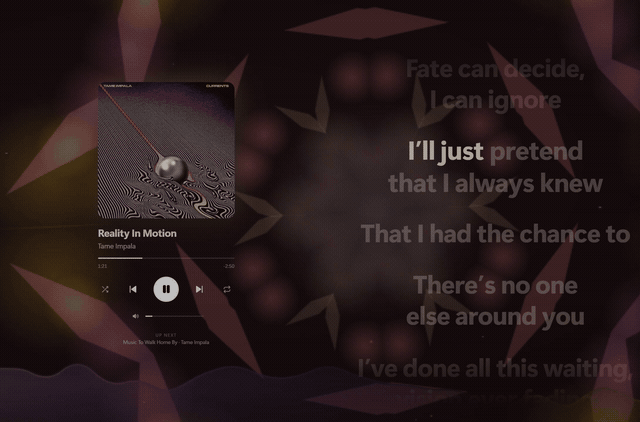

# helios
music lyrics view &amp; player acting as a spotify device



## Setup

Requires Windows x64 and Spotify Premium.

1. Download and install Helios from [Releases](https://github.com/kruthvik/helios/releases/latest).
2. Create an app in the [Spotify Developer Dashboard](https://developer.spotify.com/dashboard). Select Web API and Web Playback SDK.
3. Add `http://127.0.0.1:8898/callback` as a redirect URI in the app settings.
4. Open Helios, enter your Spotify app's client ID, and sign in. Select **Helios** as your playback device.

Spotify's development mode restrictions apply. Helios stores your Spotify refresh token unencrypted in local app data.

## Features

- Spotify playback controls and queue.
- Synced lyrics, adjustable timing, and support for your own lyric files.
- Animated backgrounds, effects, and an audio visualizer.
- Music videos and custom image, GIF, or video backgrounds.
- Custom layouts, a miniplayer, game mode, and a sleep timer.

Uses between 100-500mb RAM, depending on backgrounds, effects, etc. Further optimizations to come. Manual memory restriction & game mode included.

## How it works

Helios is a desktop app built with Tauri, Rust, Svelte, and TypeScript. It uses the Spotify Web Playback SDK and Web API to play music and control your Spotify session. Your Spotify app's client ID is used for sign-in; no client secret is needed.

Lyrics are fetched from LRCLIB and NetEase when available. You can pick a different match, adjust the timing, or load an LRC, SRT, VTT, or text file. Lyrics and timing depend on what the sources provide.

Music videos are searched on YouTube. The visualizer reads the audio playing on Windows. Settings and custom backgrounds are stored locally. Spotify, lyric providers, and YouTube receive requests when their features are used.

## Controls

| Key | Action |
| --- | --- |
| Space | Play or pause |
| Q | Open the queue |
| P | Toggle the miniplayer |
| G | Toggle game mode |
| T / F | TV mode / fullscreen |
| V | Open the music video |
| [ / ] | Adjust lyrics timing for the current song |
| , | Open settings |

More shortcuts and display options are in Settings.

## Build from source

Install [Bun](https://bun.sh/) and the [Tauri prerequisites](https://v2.tauri.app/start/prerequisites/), including Rust and the Windows build tools. Then run:

```sh
bun install
bun run tauri dev
```

Run `bun run tauri build` to build an installer.
